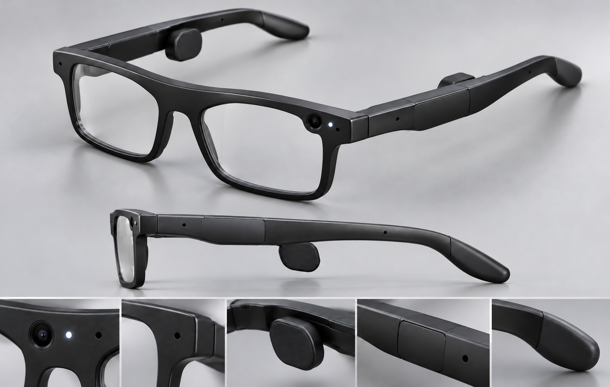

# FOCUS RevG — everyday glasses design direction

Date 2026-10-30. Reference: the general visual restraint of contemporary smart eyeglasses, including the [Ray-Ban Meta Wayfarer product presentation](https://www.ray-ban.com/usa/electronics/RW4012ray-ban%20meta%20wayfarer%20-%20gen%202-black/8056262721377). This is an original FOCUS shape direction, not an exact frame copy or a claim of comparable mass, battery life or maturity.

The rendering is an **image-generated visual concept** derived from the earlier RevG styling image. It is not a measured rendering of the RevG FreeCAD solids. The eyewear in the image is intentionally attractive but its apparently slender arms have **not** been proved to contain the modem, board, antenna and a pack that achieves two hours of full operation. Use it as an exterior brief, never a fit or mass drawing.

## Original visual language

- Clear rectangular lens openings with modestly rounded outer corners, medium-height brow, no protruding rectangular electronics box on the front.
- Matte charcoal frame, low-gloss service seam at the temples. No Meta or Ray-Ban branding, signature hinge, exact shape, ornamental imitation or reliance on their IP.
- The revised exterior places the camera and visible capture indicator on the **viewer-right upper outer brow**, leaving the bridge visually clean. The compact CAD screen moves the provisional 62 mm B0441 board envelope to x=4–66 mm and the aperture centre to x=55 mm in its front-facing coordinates; it also moves the nearby front-right microphone allowance to x=72 mm. This is an *offset placement study*, not a confirmed B0441 optical-axis fit: the actual supplier board's lens location, cable exit, viewing angle, nearby microphone spacing and indicator routing must be verified before freezing this position.
- Four discrete, external mic ports at surveyed coordinates with acoustically matched port treatment and a shared sample clock. Avoid merely drawing four holes while recording one channel.
- Two bone-conduction contacts sit in front of the ears and require 3-axis adjustment, soft skin interface and measured preload. Their pads are separate from the temple outer skin; no in-ear buds.
- Arms distribute real volumes: power/battery on one side, host/modem/SIM on the other, with RF keepout at a viable antenna location. Smooth local volume transitions are preferred; their widest physical cross-section is set by proven PCB/pack stackup, not by the rendering.
- User selection is by pointing/choosing the person, with visible uncertain state when face-to-voice matching cannot be established. Add tactile mute and status indication; the exact controls are an engineering interface, not just decorative dots.

## Packaging reality check

The present first-pass RevG CAD is a **large detachable-temple engineering volume study**. Its assumed polymer + catalog BS08 + historical 500 mAh reference subtotal is **98.86 g** before camera, mainboards, modem, antenna, connectors, lenses, cabling, insulation and larger battery. That subtotal fails both the user's 60 g target and 70 g conditional ceiling. The build has no approved antenna fit and failed 21 sampled candidate folding poses; detachable rigid temples were chosen so the failure is not hidden. See `mechanical/cad_checks.json`. The 500 mAh battery reference also misses the two-hour demand even under a hypothetical 2 W load.

Consequently the exterior in the concept image **cannot be frozen** as an integrated wearable. The next geometry iteration needs a measured power budget and actual board/pack suppliers. If those demand thicker arms or a different topology, revise the exterior truthfully. A remote GPU over LTE might itself fail the 150 ms p95 objective; the hardware styling cannot remove that delay.

## Compact native-CAD screen

A separate, narrower native FreeCAD variant is under `mechanical/compact_direction/`, with its own STEP, JSON checks, mass CSV and [assembly review drawing](mechanical/compact_direction/RevG_assembly_review.svg). Its left/right shell widths screen at 28/34 mm and 19 mm shell height; these are **still markedly bulkier than ordinary glasses**. The calculated partial mass fell from 98.86 g to **90.51 g**. All native solids passed geometry validity and the selected static Boolean collision check found none, but **16 sampled folding poses still collide** and the historical flex antenna still does not fit the assigned keepout. Because camera, actual boards, selected battery, lenses and many fasteners remain unweighed, 90.51 g is a lower subtotal, not product mass. This variant also fails the 60 g target and the conditional 70 g ceiling before those additions.

This is the most honest current comparison to the visual concept: the attractive slender-armed picture is an industrial-design goal, while the current standalone LTE architecture has not been shown to occupy that form. The next iteration must change measured component and power budgets, not simply hide the volume in a render.

## RevG geometry iteration brief

1. Use actual component and protection drawings to set the internal volumes; measure weights, mounted center of mass and wire/connector bend space.
2. Rebuild the front housing and arm shells around the fixed volumes with 1.5 mm nominal prototype walls initially; then use mechanical stress/DFM to reduce material. No guessing weight from a photorealistic render.
3. Sweep both hinges through full intended folding motion including components, contacts, wires, connectors and antenna; then physical cycles. The CAD screening interval must be documented, and sampled passes alone are insufficient.
4. Prototype several actual fit widths/nose supports. Record complete mass/CG, temple pressure, BC contact pressure and comfort across participants; preserve an immediate removal/mute path.
5. Re-render from the corrected native CAD, with an exploded view and dimensioned drawings. Only after actual component fit, 2 h duty test and mass evidence may the concept and engineering models be presented as the same object.

The current look is a product design target; the current CAD is a feasibility stress test. Their disagreement is an open design problem, not a completed integration.
